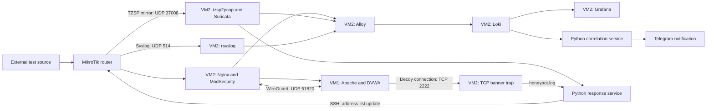

# Security Monitoring and Response Lab

A Linux / Blue Team portfolio lab combining centralized logs, network detection, a reverse proxy with a WAF, and custom response automation across two virtual machines and a MikroTik router.

This repository contains the lab architecture, setup notes and historical screenshots. Original configuration files, Python programs, systemd units, the dashboard export and raw events are not included yet, so the deployment cannot be reproduced from this repository alone. The recorded outputs cover individual stages; a complete end-to-end test record is still missing.

## Stack and topology

VM1 hosts Apache, PHP, MariaDB and DVWA. VM2 hosts Nginx, ModSecurity / OWASP CRS, Suricata, tzsp2pcap, rsyslog, Grafana Loki, Grafana Alloy, Grafana OSS and Python automation. MikroTik provides routing, mirroring, logging and address-list based firewall rules. WireGuard provides an administrative path between the VMs.

The VMs share a virtual switch. Their direct traffic bypasses the router mirror, so Suricata does not observe that east-west path. The WireGuard edge denotes the VM2 host, not an Nginx feature. See [architecture](docs/architecture.md) for flows and consistently substituted addresses.

## Implemented behavior and evidence

The screenshots show active Loki, Alloy and Grafana services; Grafana panels containing the four source categories; WAF denial log entries; WireGuard handshake/transfer output; trap connections, response-service messages and a router quarantine entry. These are observations from individual screenshots, not a fresh end-to-end validation. The [image index](docs/screenshots.md) explains all 25 images, including duplicates and ambiguous results.

Three response scenarios are described:

| Scenario | Logic | Evidence and limits |
| --- | --- | --- |
| Correlated notification | More than five ModSecurity blocks in one minute AND an `ET SCAN.*` Suricata signature from the same IP; poll every 60 seconds, ten-minute per-IP cooldown | Dashboard and running correlation service visible; exact queries, negative tests and a sanitized Telegram delivery record absent |
| External source blocking | Suricata alert leads to an SSH update of MikroTik `suricata-block` | Router list and response journal visible; early EVE/priority-1 description differs from the later `fast.log` implementation |
| Decoy-triggered WAN quarantine | VM1 connects to VM2's TCP banner trap; the response service adds VM1 to `quarantine` | Trap log, reaction journal and router membership visible; internet loss and preserved internal/admin reachability are documented, without ping/SSH evidence |

IP matching links observations; it does not establish an attack or identify a person. The TCP banner trap is not a full SSH server, and WAN quarantine is not full network isolation.

## Screenshot highlights

Grafana overview with identifying address columns and browser details masked:

| Evidence | Visible result |
| --- | --- |
| [Grafana source panels and combined table](assets/screenshots/s02-grafana-source-panels.png) | Four log-source panels and per-source counts |
| [ModSecurity denials](assets/screenshots/s23-modsecurity-denials.png) | HTTP 403, CRS rule 949110 and request paths |
| [Response-service journal](assets/screenshots/s10-response-journal.png) | Trap reaction and blocklist-addition messages |
| [MikroTik quarantine](assets/screenshots/s17-router-quarantine.png) | Quarantine list membership |
| [MikroTik blocklists](assets/screenshots/s24-router-blocklists.png) | List entries, creation times and selected timeouts |
| [WireGuard status](assets/screenshots/s13-wireguard-status.png) | Handshake and transfer counters |

The [full gallery](assets/screenshots/README.md) includes all 25 images and their limits. Counts are historical snapshots; duplicate images and different test stages are labelled. These screenshots do not establish a synchronized end-to-end test or unmask source-IP matching.

## Read the evidence

Start with the [test matrix](docs/testing.md), [detection and response](docs/detection-and-response.md), and [controlled-test runbook](docs/evidence-runbook.md). The [screenshot gallery](assets/screenshots/README.md) includes all 25 reviewed copies: 23 with opaque masks over identifying fields and two with metadata removed only. Original reports and images remain private. The [Russian project report](docs/report.ru.md) describes the setup and test stages.

[Deployment](docs/deployment.md), [troubleshooting](docs/troubleshooting.md), [limitations](docs/limitations.md) and the [VM export checklist](docs/artifact-request.md) describe what is known and what is needed next. The [inventory](docs/material-inventory.md) separates available material from missing artifacts; [sanitization](docs/sanitization.md) records publication boundaries.

## Repository status

This repository contains documentation and reviewed screenshot copies. Empty artifact directories contain `.gitkeep`; original scripts, dashboard JSON and runnable configurations still need to be added. No license is assigned.

The [repository status and structure](docs/repository-status.md) records current deliverables and gaps. Local document/link checks and source checksum results are recorded in [verification](docs/verification.md). They do not test the deployed lab. See [working with the repository](docs/local-commit.md) for clone and review commands.
