# Screenshot gallery

All 25 source screenshots have reviewed public copies. Twenty-three PNG copies use opaque black rectangles over identifying fields; the two service-status JPEGs only had capture metadata removed. Unmasked pixels were compared with the originals and are unchanged. Original files remain private.

These are historical observations from different stages, not one synchronized end-to-end test. Masked addresses cannot be used to independently confirm source-IP matching. See the [evidence index](../../docs/screenshots.md) and [test matrix](../../docs/testing.md).

## S02 — Grafana source panels and combined table

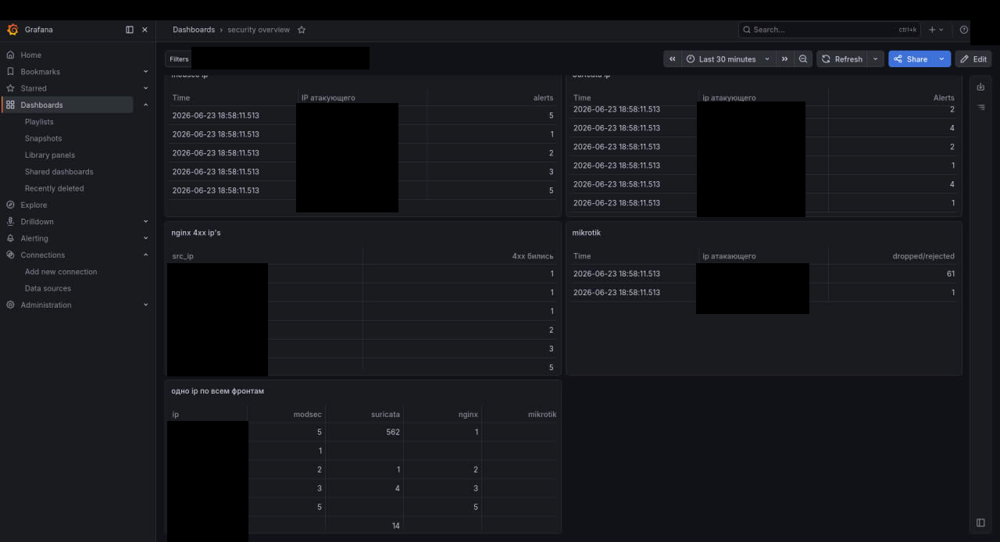

Four source panels and merged per-IP table visible. No query/export or delivery result. Address columns and the filter are masked. Visible counts do not establish exact source-IP matching or the queries used.

## S03 — Grafana security overview

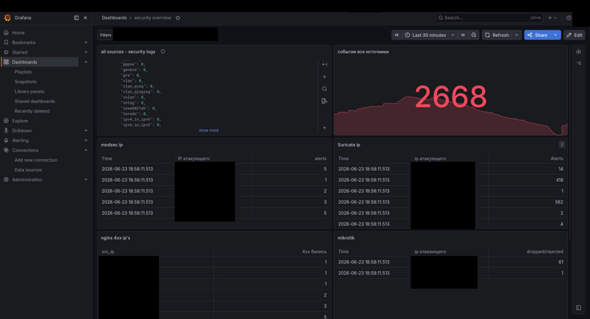

Top dashboard view: event counter 2668 and source panels. Counter is a snapshot. The 2668 event count is a historical snapshot; it is not a benchmark.

## S04 — Correlation service

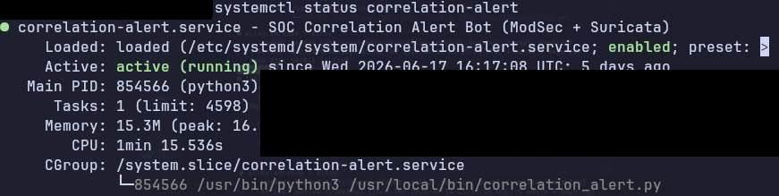

correlation-alert active/enabled; Python invocation visible. No delivered message. The service is active/enabled; this does not establish delivered notifications or cooldown behavior.

## S05 — MikroTik firewall syslog

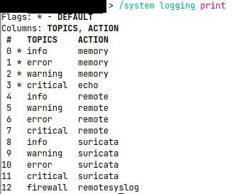

Router firewall topic routed to remotesyslog. Does not show receiver delivery. The logging configuration includes firewall to remotesyslog; receiver delivery is not shown.

## S06 — Grafana service

grafana-server active/enabled. No ingestion/delivery result. Active/enabled service state does not establish ingestion or notification delivery.

## S07 — Alloy and Loki services

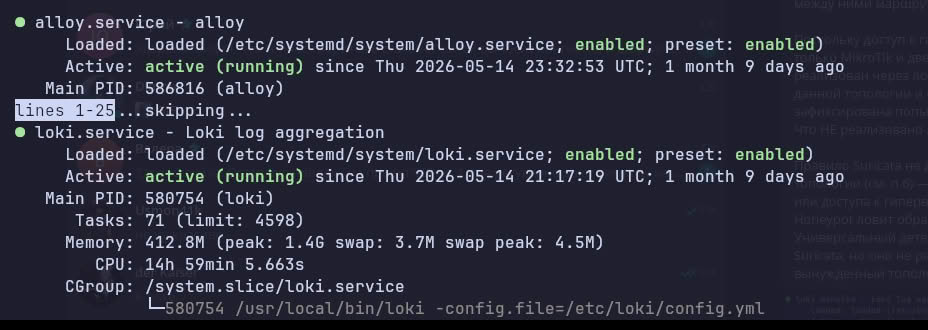

Alloy and Loki active/enabled, two unit outputs; overlaps S08/S09. Overlaps the individual Alloy/Loki status images; it is not an independent test.

## S08 — Alloy service

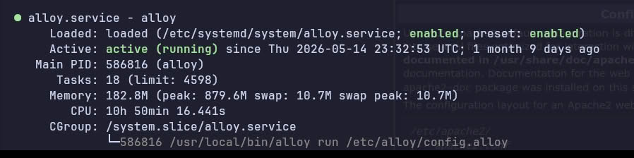

Alloy active/enabled, config invocation and historical memory output. Active/enabled service state does not establish completeness of log collection.

## S09 — Loki service

Loki active/enabled and config argument. Memory value is historical. Memory output is historical and is not a performance benchmark.

## S10 — Response service journal

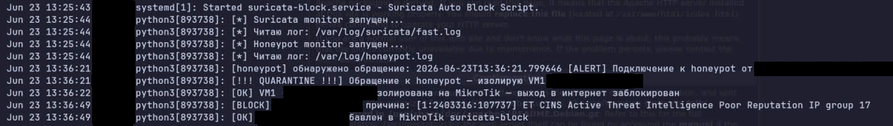

Journal identifies fast.log and trap monitor; quarantine and external list-add messages. Journal messages describe list additions; firewall effect and recovery are not shown.

## S11 — Trap connections

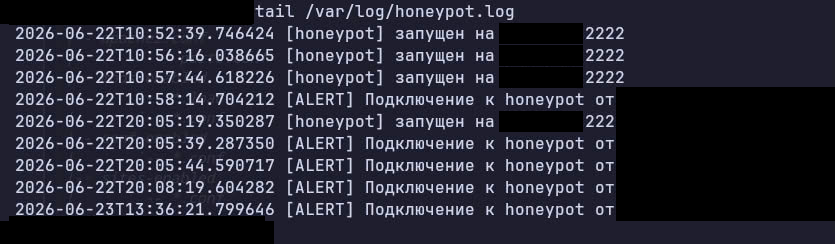

Trap listener restarts and connection lines; no complete SSH exchange. Connection records do not demonstrate a complete SSH exchange.

## S12 — Decoy configuration

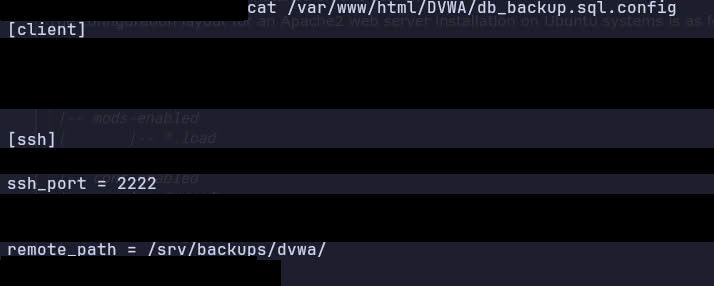

Decoy file with client/SSH sections; username differs from report wording. Entire credential rows are masked, including the fictional decoy passwords.

## S13 — WireGuard handshake and transfer

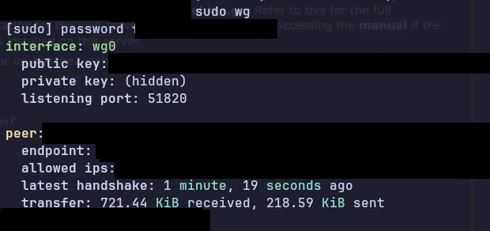

WireGuard latest handshake and received/sent bytes; private key displayed as hidden. Handshake and transfer counters remain visible; no administrative SSH session or quarantine test is shown.

## S14 — Suricata rule loading

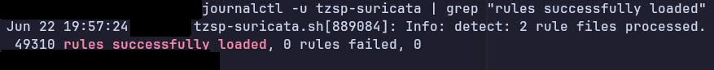

Suricata journal: two rule files, 49310 rules loaded, zero failed; no SID hit. 49310 loaded rules and zero failed rules do not establish a hit on the custom signature.

## S15 — Historical Suricata lateral-movement rule

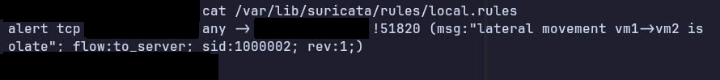

Historical TCP rule with !51820 and SID 1000002 visible. TCP and the negated port !51820 remain unchanged; see detection-and-response for the WireGuard protocol limitation.

## S16 — Response journal — overlapping evidence

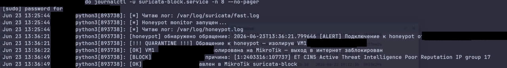

Same reaction sequence as S10; command shown; not independent evidence. Overlaps S10; this is not an additional independent response test.

## S17 — MikroTik quarantine list

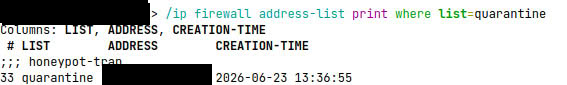

Router quarantine list includes a VM address and honeypot-trap comment. Membership is visible; WAN traffic loss, retained administration and recovery are not demonstrated.

## S18 — Grafana table — alternate view

Dashboard like S02 at a different scroll position. Separate rows, same layout. Overlaps S02 at a different scroll position; address columns are masked.

## S19 — Nginx access events

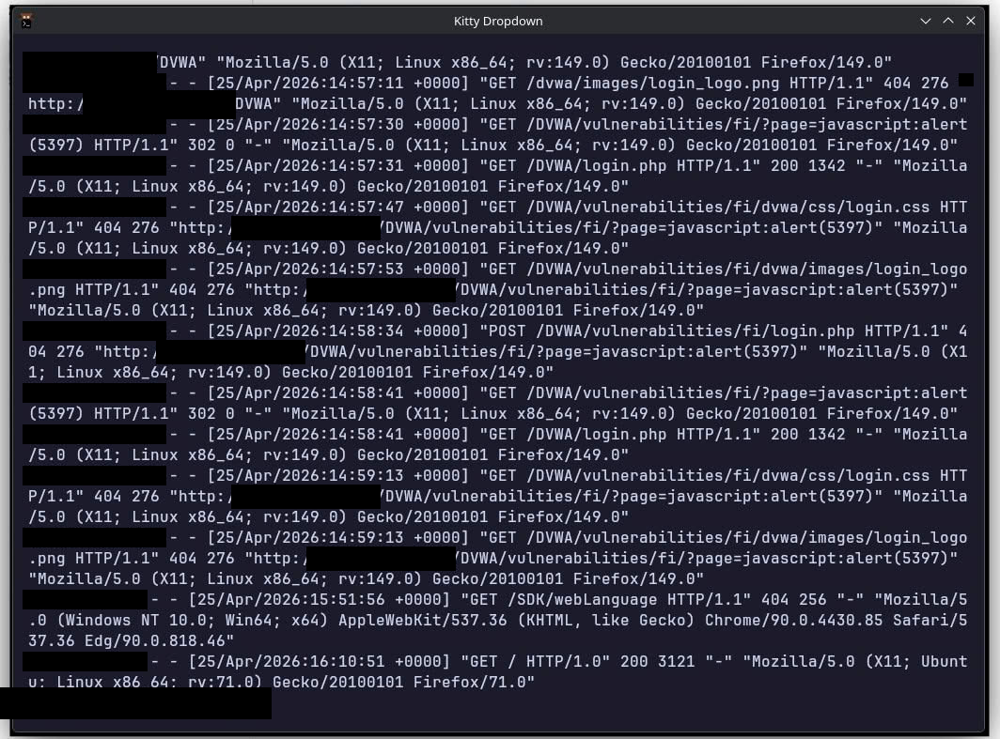

Nginx access-format output, HTTP methods/statuses and DVWA paths. HTTP methods, status codes, paths and timestamps remain visible.

## S20 — Suricata EVE events

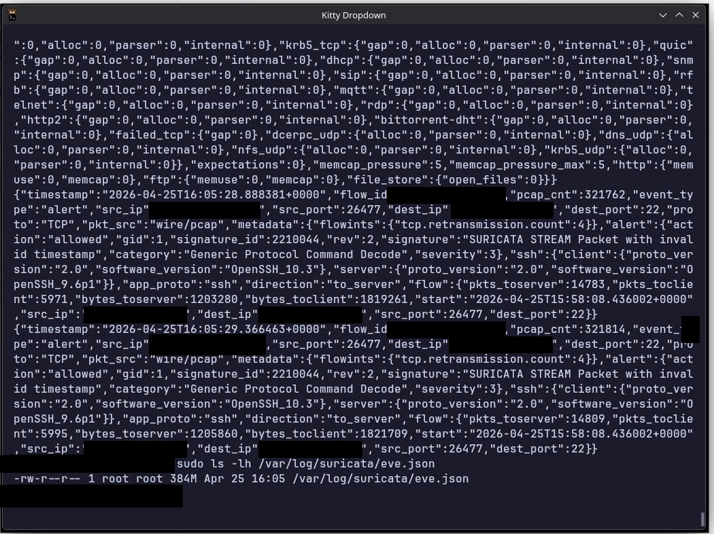

EVE JSON stats and invalid-timestamp alerts with severity 3. Not priority-1 response. The visible invalid-timestamp alerts have severity 3; this does not prove priority-1 blocking.

## S21 — Suricata fast-log events

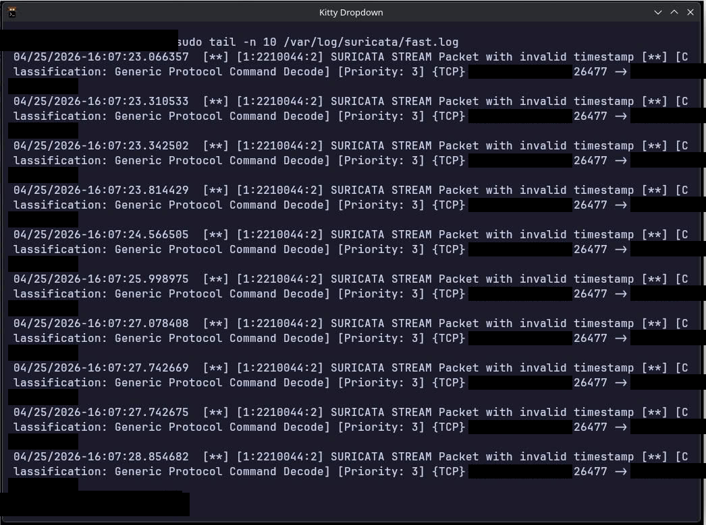

Repeated invalid-timestamp alerts, priority 3; does not prove blocking. Priority 3 alerts are visible; these entries do not establish a block.

## S22 — ModSecurity warning with HTTP 200

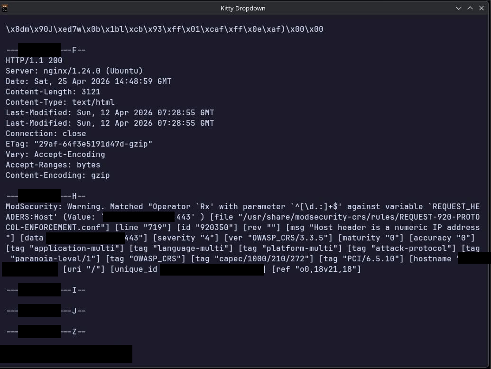

Multipart audit: numeric-Host warning, rule 920350, HTTP 200. Not a denial. Rule 920350 warns about a numeric Host header; HTTP 200 is not a denial.

## S23 — ModSecurity denials with HTTP 403

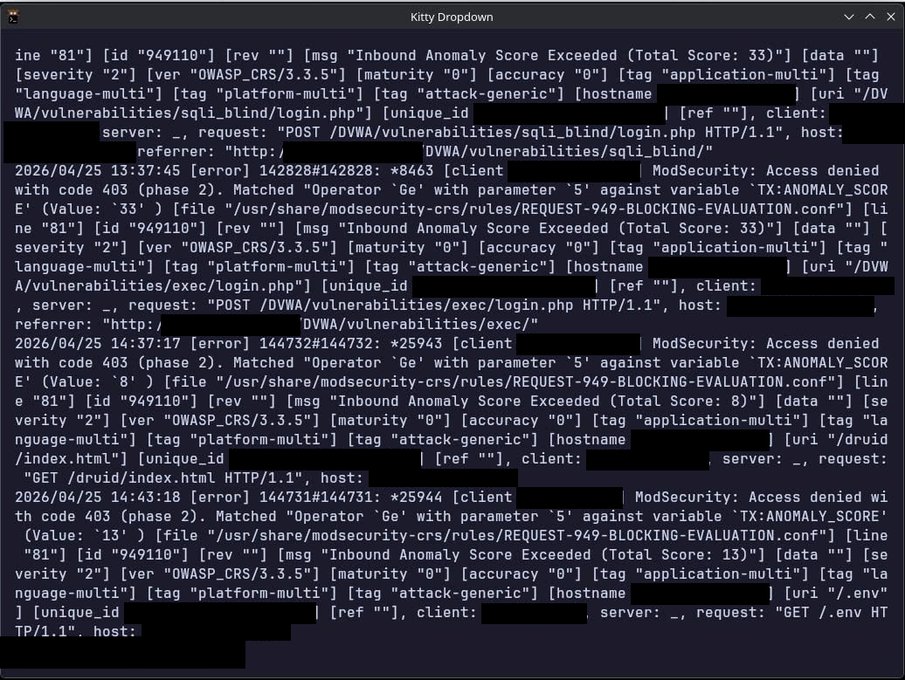

ModSecurity access denied HTTP 403 and rule 949110; several request paths. HTTP 403, rule 949110 and request paths remain visible.

## S24 — MikroTik blocklists

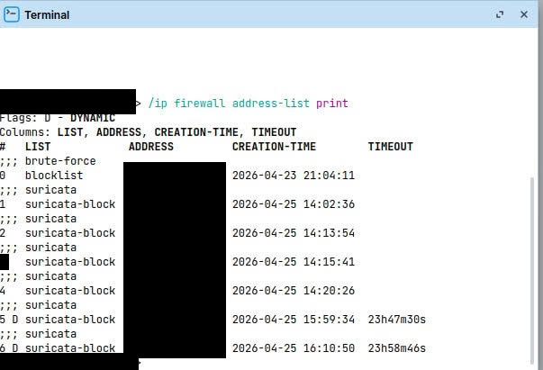

Router address list includes suricata-block entries, some with timeouts. List names, creation times and selected timeouts remain visible; enforcement is not shown.

## S25 — ZAP — before-labelled view

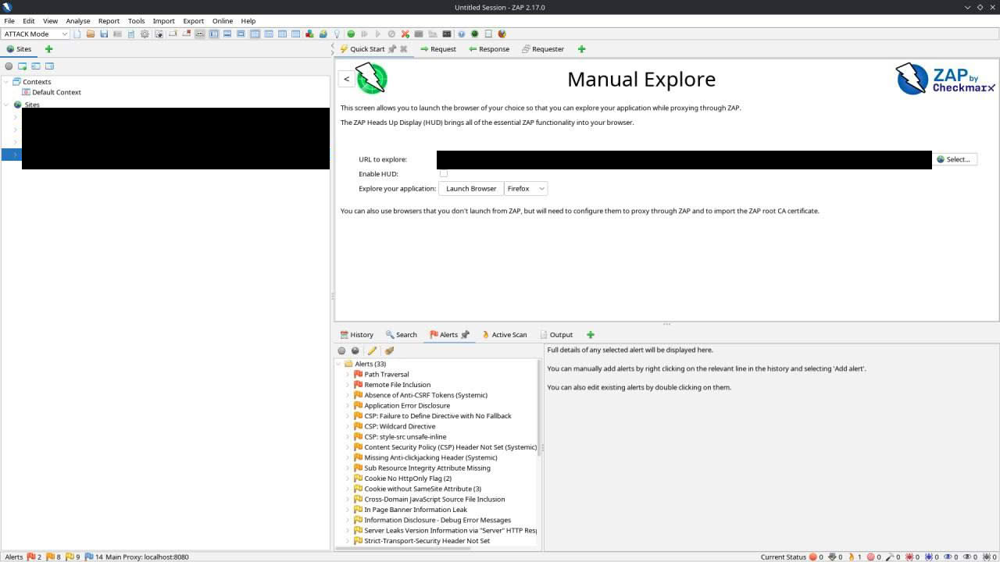

ZAP UI before-labelled image: 33 alert tree entries. Target differs from S26. 33 alert-tree entries are visible. The target differs from S26; this is not a controlled baseline.

## S26 — ZAP — after-labelled view

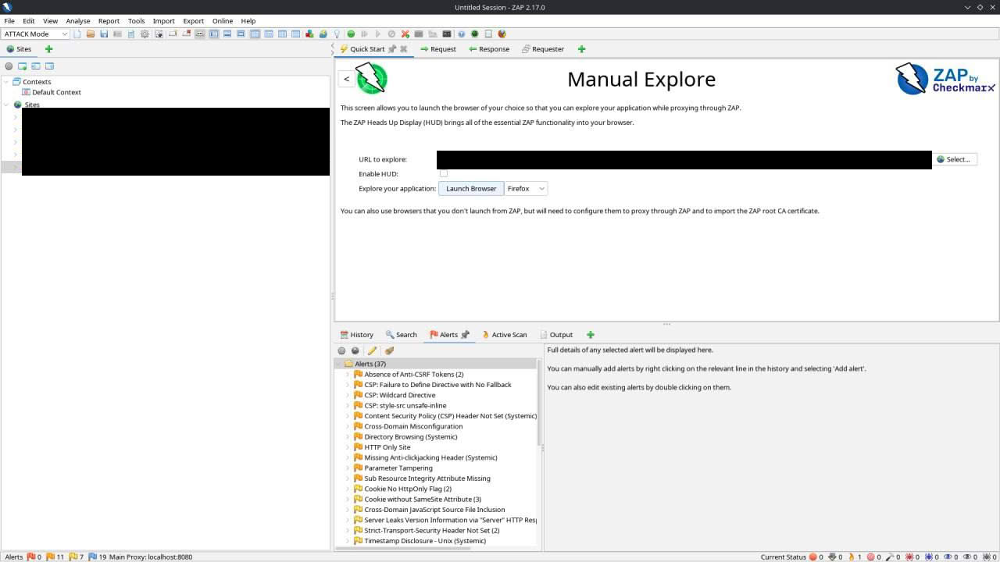

ZAP UI after-labelled image: 37 alert tree entries. No controlled baseline. 37 alert-tree entries are visible. These totals do not demonstrate a reduction in vulnerabilities.
