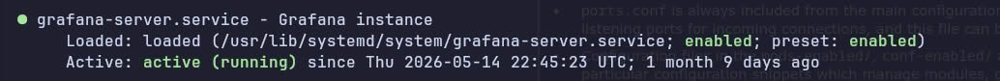
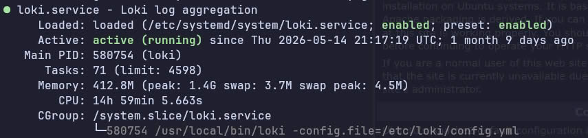

# Reviewed screenshot copies

Two selected originals have no identifying pixel text found in review. Only JPEG metadata markers were removed; no pixels were edited or regenerated. Other source images remain private pending local masking. See the [25-image index](../../docs/screenshots.md) for every source and its evidence/privacy decision.

## S06 — Grafana service

Historical systemd output shows Grafana active and enabled. It does not establish ingestion or notification delivery. Related: [deployment](../../docs/deployment.md), [testing](../../docs/testing.md).

## S09 — Loki service

Historical systemd output shows Loki active and enabled, with a configuration-file argument. Displayed memory is a point-in-time observation, not a benchmark. Related: [deployment](../../docs/deployment.md), [testing](../../docs/testing.md).
